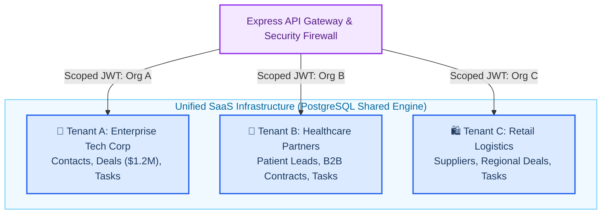
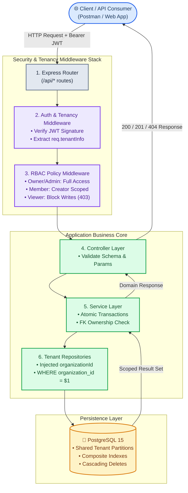
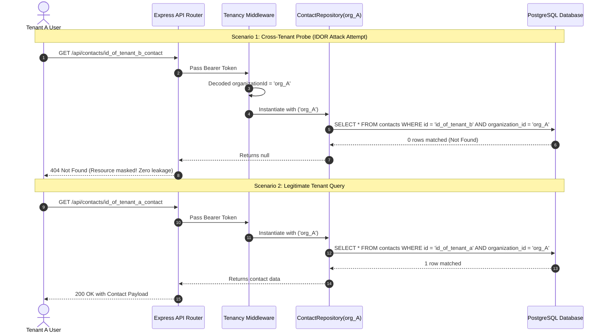
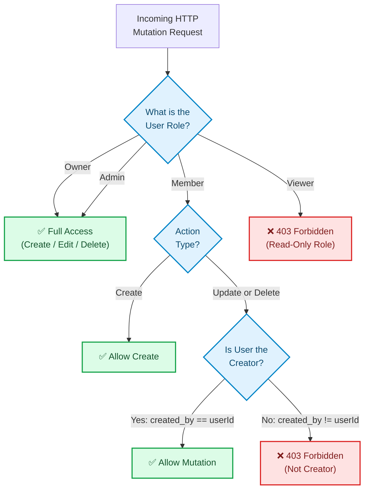
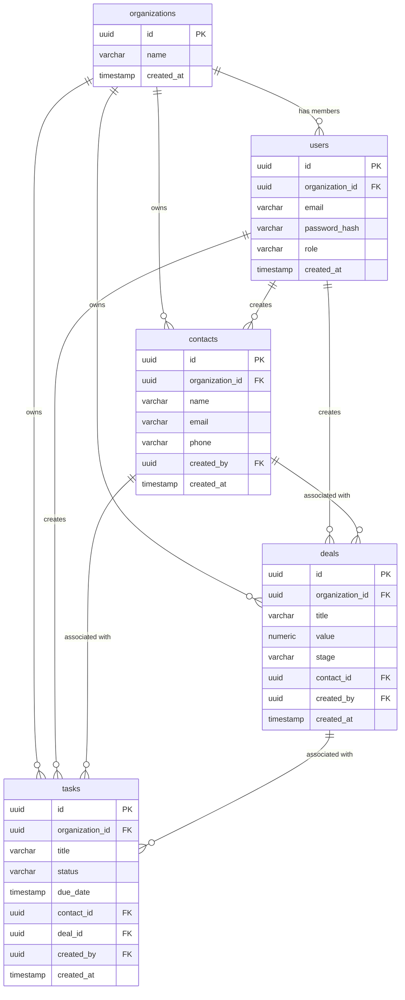

# Multi-Tenant SaaS CRM REST API with Role-Based Access Control (RBAC)


An enterprise-grade Customer Relationship Management (CRM) REST API built to power modern B2B SaaS platforms. This system implements a **Shared Database, Shared Schema** architecture to deliver absolute data isolation across different organizations (tenants), enforces constructor-injected tenant-aware repository queries, and applies comprehensive Role-Based Access Control (RBAC).

---

## 🌍 Real-World Use Cases

In modern cloud computing, multi-tenancy is the foundation of high-margin SaaS applications. Instead of deploying separate server and database instances for every client—which dramatically inflates cloud infrastructure costs—this architecture allows thousands of corporate tenants to securely coexist on a unified backend.



### Key Industry Applications
1. **Commercial B2B SaaS Platforms**: Powering CRM products (like HubSpot, Salesforce, or Pipedrive) where multiple paying corporations demand strict data privacy without cross-tenant leakage.
2. **Franchise & Regional Operations**: Allowing nationwide dealership or franchise branches to independently manage sales pipelines, contacts, and tasks while headquarters maintains global governance.
3. **Agency & Client Portals**: Enabling consulting agencies to invite external client stakeholders as **Viewers** to track deal progress and audit records without granting write or delete privileges.
4. **Cloud Infrastructure Cost Optimization**: Drastically reducing database operational costs by leveraging pooled connections and composite indexing instead of managing per-tenant database instances.

---

## 🏗️ High-Level System Architecture & Flow

Every incoming HTTP request travels through a multi-tier security pipeline before touching the database. Security is enforced as a defensive stack: **Authentication -> Tenant Extraction -> RBAC Permission Check -> Creator Ownership Verification -> Tenant-Scoped Repository Querying**.



---

## 🛡️ Multi-Tenancy & Data Isolation (Zero Leakage Strategy)

Data isolation is guaranteed through a **3-tier defense-in-depth model**:



### Why 404 Not Found instead of 403 Forbidden?
In multi-tenant environments, returning a `403 Forbidden` on an IDOR attempt is an **anti-pattern** because it confirms that the resource ID exists in someone else's organization, enabling malicious ID harvesting. Returning `404 Not Found` completely masks the existence of foreign tenant records.

### Foreign Key Ownership Verification (Anti-Hijacking)
When creating a Deal or Task linked to a Contact, standard database foreign keys only verify that the `contact_id` exists—they do not ensure it belongs to the *same* tenant.  
Our Service layer explicitly queries `contactRepo.findById(contact_id)` under the current tenant's scope before writing to the database. If a malicious user attempts to attach their deal to a contact from another tenant, the system rejects it with `400 Bad Request`.

---

## 🔐 Role-Based Access Control (RBAC) Matrix

Users belong to one of four hierarchical roles. The permission engine checks both role tier and record creator:



| Permission / Action | Owner | Admin | Member | Viewer |
| :--- | :---: | :---: | :---: | :---: |
| **Invite New Users** | ✅ Yes | ✅ Yes | ❌ No (403) | ❌ No (403) |
| **View Contacts / Deals / Tasks** | ✅ Yes | ✅ Yes | ✅ Yes | ✅ Yes |
| **Create Contacts / Deals / Tasks** | ✅ Yes | ✅ Yes | ✅ Yes | ❌ No (403) |
| **Update Contacts / Deals / Tasks** | ✅ All Records | ✅ All Records | ⚠️ **Only if Creator** | ❌ No (403) |
| **Delete Contacts / Deals / Tasks** | ✅ All Records | ✅ All Records | ⚠️ **Only if Creator** | ❌ No (403) |
| **View Org Analytics Dashboard** | ✅ Yes | ✅ Yes | ✅ Yes | ✅ Yes |

---

## 🗄️ Database Schema & Entity Relationship Diagram (ERD)

The database schema is designed for multi-tenancy with strict foreign key constraints and index optimizations:



### Database Performance & Composite Indexes
To ensure sub-millisecond query performance as tenant data scales into millions of rows, the following indexes are defined in `src/models/schema.sql`:
* `idx_users_org_id` on `users(organization_id)`
* `idx_contacts_org_id` on `contacts(organization_id)`
* `idx_contacts_org_id_email` on `contacts(organization_id, email)`
* `idx_deals_org_id` on `deals(organization_id)`
* `idx_deals_org_id_stage` on `deals(organization_id, stage)` *(Optimizes `/api/dashboard` stage aggregations)*
* `idx_tasks_org_id` on `tasks(organization_id)`
* `idx_tasks_org_id_status` on `tasks(organization_id, status)` *(Optimizes `/api/dashboard` pending task counts)*
* Foreign key index lookups on `deals(contact_id)`, `tasks(contact_id)`, and `tasks(deal_id)`.

---

## 📂 Project Directory Structure

```plaintext
SaaS-CRM-API/
├── Dockerfile                  # Container build instructions for API server
├── docker-compose.yml          # Multi-container orchestration (API + PostgreSQL)
├── package.json                # Project dependencies and test scripts
├── swagger.yaml                # Complete OpenAPI 3.0 API specification
├── .env.example                # Template for environment variables
├── src/
│   ├── app.js                  # Express app setup, Swagger UI mount & centralized error handling
│   ├── controllers/            # HTTP request parameter extraction and response formatting
│   │   ├── authController.js   # Registration, login, profile endpoints
│   │   ├── crmController.js    # Contacts, Deals, Tasks, Dashboard endpoints
│   │   └── orgController.js    # Organization user invitations
│   ├── middlewares/            # Interceptor pipeline
│   │   ├── authMiddleware.js   # JWT validation & tenant context attachment
│   │   └── rbacMiddleware.js   # Role-based route guard
│   ├── models/                 # Database initialization and DDL schemas
│   │   ├── db.js               # PostgreSQL connection pool configuration
│   │   └── schema.sql          # Table definitions, constraints, and composite indexes
│   ├── repositories/           # Constructor-injected tenant-scoped data access layer
│   │   ├── contactRepository.js
│   │   ├── dealRepository.js
│   │   ├── taskRepository.js
│   │   └── userRepository.js
│   └── services/               # Core business logic, transaction management & FK verification
│       ├── authService.js      # Atomic registration with BEGIN/COMMIT/ROLLBACK
│       ├── crmService.js       # Cross-tenant integrity, dashboard aggregations, creator checks
│       └── orgService.js       # User invitation management
└── tests/                      # Automated integration and isolation test suite
    └── integration/
        └── crm.test.js         # Comprehensive IDOR, RBAC, and transaction test cases
```

---

## 🚀 Setup & Execution Guide

### Prerequisites
* [Docker Desktop](https://www.docker.com/products/docker-desktop) installed and running, OR
* [Node.js](https://nodejs.org/) (v18+) and [PostgreSQL](https://www.postgresql.org/) (v14+) installed locally.

### Environment Configuration
Create a `.env` file from the example template:
```bash
cp .env.example .env
```

Default configuration in `.env`:
```env
PORT=8080
DB_USER=postgres
DB_PASSWORD=postgres
DB_HOST=localhost
DB_PORT=5432
DB_NAME=saas_crm
JWT_SECRET=super_secret_jwt_key_for_saas_crm_api
```

---

### Option 1: Run with Docker Compose (Recommended)

Boot the entire containerized stack with a single command:
```bash
docker-compose up -d --build
```
* **API Service**: Running on [http://localhost:8080](http://localhost:8080)
* **PostgreSQL Database**: Running on port `5432` with auto-initialized schema migrations.

To stop the containers:
```bash
docker-compose down
```

---

### Option 2: Run & Test Locally

#### Handling Local PostgreSQL Port Conflicts
If you already have a local PostgreSQL instance running natively on port `5432`, avoid conflicts by mapping the Docker database container to port `5434`:
1. In your `.env`, set:
   ```env
   DB_PORT=5434
   DB_HOST_PORT=5434
   ```
2. Start only the PostgreSQL database container:
   ```bash
   docker-compose up -d db
   ```
3. Install dependencies and start the API in development mode:
   ```bash
   npm install
   npm run dev
   ```

#### Execute Automated Test Suite
To run the automated integration tests:
```bash
npm test
```
The test suite validates:
* Organization + Owner registration within an atomic transaction.
* JWT generation containing `userId`, `organizationId`, and `role`.
* Cross-tenant IDOR attacks masked with `404 Not Found`.
* Foreign key hijacking attempts rejected with `400 Bad Request`.
* Viewer role mutation blockages enforced with `403 Forbidden`.
* Member role creator-based update and delete constraints.
* Dashboard statistics aggregations strictly bounded by tenant ID.

---

## 📖 API Documentation & Swagger UI

The complete OpenAPI 3.0 specification is available interactively when the server is running:

* **Interactive Swagger UI**: Navigate to [http://localhost:8080/api-docs](http://localhost:8080/api-docs)
* **OpenAPI Raw Specification**: [swagger.yaml](swagger.yaml)

### Summary of REST Endpoints

| Category | Method | Endpoint | Description | Role Required |
| :--- | :--- | :--- | :--- | :--- |
| **Auth** | `POST` | `/api/auth/register` | Register new organization + owner user | Public |
| **Auth** | `POST` | `/api/auth/login` | Authenticate user & receive tenant-scoped JWT | Public |
| **Auth** | `GET` | `/api/auth/me` | Get authenticated user profile & tenant info | Authenticated |
| **Organizations** | `POST` | `/api/organizations/invites` | Invite new user to current tenant | Owner, Admin |
| **Contacts** | `GET` | `/api/contacts` | List all contacts in tenant | Any role |
| **Contacts** | `POST` | `/api/contacts` | Create a contact | Owner, Admin, Member |
| **Contacts** | `GET` | `/api/contacts/:id` | Get contact by ID (tenant-scoped) | Any role |
| **Contacts** | `PUT` | `/api/contacts/:id` | Update contact (creator or admin/owner) | Owner, Admin, Member |
| **Contacts** | `DELETE` | `/api/contacts/:id` | Delete contact (creator or admin/owner) | Owner, Admin, Member |
| **Deals** | `GET` | `/api/deals` | List all deals in tenant | Any role |
| **Deals** | `POST` | `/api/deals` | Create deal (validates contact ownership) | Owner, Admin, Member |
| **Deals** | `GET` | `/api/deals/:id` | Get deal by ID (tenant-scoped) | Any role |
| **Deals** | `PUT` | `/api/deals/:id` | Update deal | Owner, Admin, Member |
| **Deals** | `DELETE` | `/api/deals/:id` | Delete deal | Owner, Admin, Member |
| **Tasks** | `GET` | `/api/tasks` | List all tasks in tenant | Any role |
| **Tasks** | `POST` | `/api/tasks` | Create task (validates contact & deal ownership) | Owner, Admin, Member |
| **Tasks** | `GET` | `/api/tasks/:id` | Get task by ID (tenant-scoped) | Any role |
| **Tasks** | `PUT` | `/api/tasks/:id` | Update task | Owner, Admin, Member |
| **Tasks** | `DELETE` | `/api/tasks/:id` | Delete task | Owner, Admin, Member |
| **Dashboard** | `GET` | `/api/dashboard` | Get aggregate CRM statistics for tenant | Any role |

---

## 🚀 Future Scope & Planned Improvements

The current implementation is production-ready for core multi-tenant CRM operations. The following enhancements are planned for future iterations:

### 1. PostgreSQL Row-Level Security (RLS)
Add database-engine-level tenant enforcement using PostgreSQL RLS policies. This would act as a second layer of defense — even if application-level scoping were bypassed, the database engine itself would block cross-tenant access.

### 2. Email-Based Invitation Flow
Replace the current temporary password system with a proper email invitation workflow. Invited users would receive a secure, expiring token link to set their own password before first login, following industry-standard onboarding practices.

### 3. Cursor-Based Pagination & Filtering
Implement cursor-based pagination on all list endpoints (`/contacts`, `/deals`, `/tasks`) with support for field-level filtering and sorting. This prevents performance degradation as tenant datasets grow to thousands of records.

### 4. Redis Distributed Caching & Rate Limiting
Integrate Redis to cache frequently accessed dashboard aggregations and enforce per-tenant API rate limits. This prevents any single tenant from monopolizing shared compute resources under high load.

### 5. Audit Log Trail
Record all write operations (create, update, delete) to an immutable `audit_logs` table with actor, timestamp, action type, and before/after state. This supports compliance requirements (GDPR, SOC 2) for enterprise customers.
